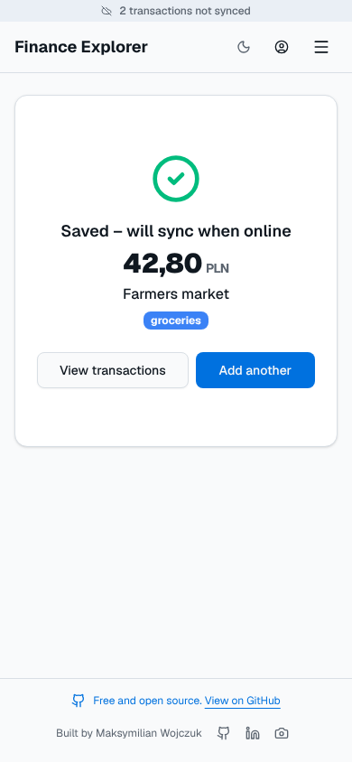
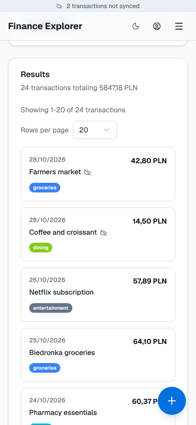
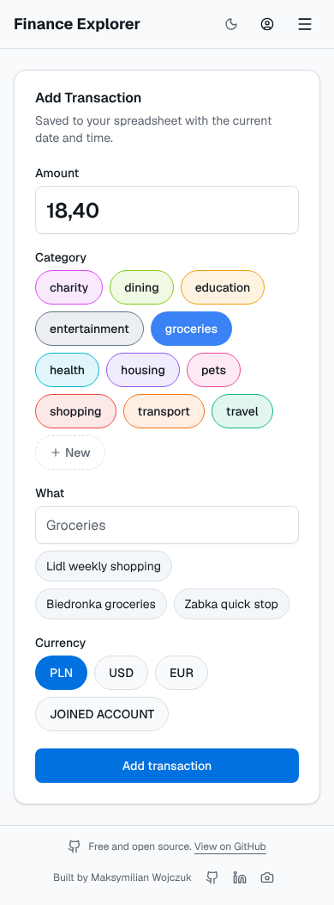

# Personal Finance Explorer

<p align="center">
  
</p>

[](https://vercel.com/new/clone?repository-url=https%3A%2F%2Fgithub.com%2Fmaxiwoj%2Fpersonal-finance-explorer&env=NEXT_PUBLIC_GOOGLE_CLIENT_ID,GOOGLE_CLIENT_SECRET,NEXT_PUBLIC_GOOGLE_API_KEY,NEXT_PUBLIC_GOOGLE_APP_ID&envDescription=Required%20Google%20OAuth%20client%20ID%20and%20secret%2C%20Picker%20API%20key%2C%20and%20Cloud%20project%20number.%20See%20the%20Deployment%20Guide%20for%20setup%20instructions.&envLink=https%3A%2F%2Fgithub.com%2Fmaxiwoj%2Fpersonal-finance-explorer%2Fblob%2Fmain%2Fdocs%2Fdeployment.md%233-environment-variables)

A powerful, privacy-focused personal finance dashboard that turns your Google Sheets into a rich, interactive explorer. Built with Next.js, Google OAuth 2.0, and high-performance charting.

[](https://v0-personal-finance-dashboard-eta-seven.vercel.app/)


## Why Personal Finance Explorer?

- **Your data stays in your Google Sheet**: There is no database. Transactions are read from and written to the Google Sheets API directly in your browser; the app's server never receives them.
- **Minimal Google access**: Only the `drive.file` scope (plus your email for sign-in), so the app can open just the spreadsheet you pick, not the rest of your Drive. It writes only when you add, edit, return or delete a transaction, and only the input columns (Timestamp to Currency, TransactionID, Notes and ReturnOf) of the `expenses` tab, when you manage currencies in the `currencyDates` tab, or when you manage or approve recurring payments in the `recurring` tab.
- **Local cache only**: Transactions are cached in your browser (IndexedDB) for fast loads and cleared on sign-out. Transactions added offline wait in a separate on-device queue until they reach your sheet.
- **No vendor lock-in**: Keep using Sheets however you like; the app is just a view on top. Self-host your own instance in one click.
- **Server is auth-only**: The backend just exchanges and refreshes Google OAuth tokens (refresh token kept in an HTTP-only cookie).

> Note: the app includes [Vercel Web Analytics](https://vercel.com/docs/analytics) for page-view stats. It does not receive your spreadsheet data.

## Add Transactions Anywhere, Even Offline

Install the app on your phone's Home Screen and adding an expense takes seconds, whatever the connection:

- **Opens straight on the Add page**, loads without a network after one online visit, and shows your cached data at once while it refreshes in the background. Built for slow connections: the form needs a single Sheets request, and the Google sign-in script loads only when you sign in.
- **Saving never waits for the network**: a new transaction is stored on the device and the saved screen shows immediately. It is sent to your sheet in the background, right away when online, or as soon as the connection is back (on reconnect or when you reopen the app).
- **No duplicate rows**: each transaction gets its ID when saved, and a retry first checks the sheet for it.
- **You always know what's pending**: unsynced transactions are listed and marked in the Transactions view, a bar shows what is waiting or failed (with **Retry**), and signing out warns you before leaving unsynced transactions behind.

<p>
  
  
</p>

Returns, edits and deletes still need a connection, and saving offline needs [stored transaction IDs](./docs/migrations/stable-transaction-ids.md). See [Install as an App](./docs/deployment.md#6-install-as-an-app-offline) for setup and details.

## Try the Live Demo

Want to see the app in action? Visit the [live demo](https://v0-personal-finance-dashboard-eta-seven.vercel.app/) to experience the full functionality with sample data.

**Note**: The demo is deployed with sample data for demonstration purposes. To use your own data, sign in with Google, make a copy of the [template spreadsheet](https://docs.google.com/spreadsheets/d/1KTNJ1fwJbM3uFzJzz3Duc2MP88Ybx2OiXrYa51cooKo/copy), and select it with the built-in Google Drive picker. The app can only access the file you select.

## Features

- **Google Sheets Integration**: Directly syncs with your Google Spreadsheet, selected from your Drive after sign-in. The app can only access the file you select and does not store any of your data on its servers.
- **Interactive Dashboard**: Get a high-level overview of your spending, income, and net flow with dynamic charts.
- **Detailed Transaction Explorer**: Search, filter, and drill down into every transaction.
- **Add Transactions**: A mobile-first Add page (`/add`, or the floating **+** button on phones): amount first, one-tap category and currency buttons, and your frequent descriptions as one-tap picks for the selected category. New rows are appended to the `expenses` tab; the sheet's formulas fill in the derived columns.
- **Edit Transactions**: Fix the amount, description, category, currency, date or notes from the transaction details. Only the changed cells are written, and the edit is refused if the row changed in the sheet in the meantime. Transactions can also be deleted; a purchase with returns only once its returns are removed.
- **Returns**: Record a full or partial return from the transaction details, or remove one to revert it. The purchase keeps its original price and counts at its net amount in its own month. Needs stored transaction IDs; see [Stable transaction IDs](./docs/migrations/stable-transaction-ids.md) for updating an older spreadsheet.
- **Fixed Category Order and Colors**: An optional `categories` tab sets the order of the category buttons and each category's color across the app. The Add page can create it from your existing categories.
- **Currencies**: Amounts are shown in the default currency from `currencyDates!B1`. The **Currencies** page (account menu) adds a currency converted with Google Finance rates, or a fixed multiplier such as 0.5 for a joint account; it also changes a multiplier or the default currency (with a warning about transactions converted silently) and removes unused currencies. See [Currencies](./docs/currencies.md).
- **Recurring Payments**: Set up payments that repeat, such as rent or subscriptions: the same fields as a transaction plus how often it repeats (every N days, weeks, months or years), the first date and an optional end. When one is due it shows as a draft on the **Transactions** page to approve (added as a transaction) or remove. Manage them on the **Recurring payments** page (account menu); they are kept in a `recurring` tab, created with the first one. See [Recurring payments](./docs/recurring-payments.md).
- **Manage Categories on the Add Page**: **Manage categories** adds categories or hides ones you no longer use from the Add page. Hidden categories stay in the `categories` tab (column C) with their color, still appear when editing, and their transactions do not change.
- **Quick Add on iPhone, also offline**: Open `/add` in Safari and tap **Share → Add to Home Screen**. The installed app opens on the Add page, also offline after one online visit, and updates itself; sign in once inside it. New transactions are saved on the device at once and synced in the background (see [above](#add-transactions-anywhere-even-offline)). See [Install as an App](./docs/deployment.md#6-install-as-an-app-offline).
- **Multi-dimensional Filtering**: Filter by date range, month/year, and categories.
- **Privacy First**: Authenticate with Google OAuth and keep your data in your own spreadsheet.

## Screenshots

### Transactions Explorer


### Add Transaction


### Finance Analysis
#### Categories


#### Category Deep Dive


## Development getting started

### Prerequisites

- Node.js 18.x or later
- A Google Cloud Project with the Google Sheets API and Google Picker API enabled
- A Google Spreadsheet with your financial data in the [template](https://docs.google.com/spreadsheets/d/1KTNJ1fwJbM3uFzJzz3Duc2MP88Ybx2OiXrYa51cooKo/copy) format

### Development

1. **Clone the repository:**
   ```bash
   git clone https://github.com/your-username/personal-finance-explorer.git
   cd personal-finance-explorer
   ```

2. **Install dependencies:**
   ```bash
   pnpm install
   ```

3. **Configure Environment Variables:**
   Create a `.env.local` file in the root directory and add the following:
   ```env
   NEXT_PUBLIC_GOOGLE_CLIENT_ID=your_client_id
   NEXT_PUBLIC_GOOGLE_API_KEY=your_picker_api_key
   NEXT_PUBLIC_GOOGLE_APP_ID=your_cloud_project_number
   # Optional: spreadsheet tried before asking the user to pick one
   NEXT_PUBLIC_SPREADSHEET_ID=your_spreadsheet_id
   GOOGLE_CLIENT_SECRET=your_client_secret
   ```
   *For detailed setup instructions, see the [Deployment Guide](./docs/deployment.md).*

4. **Run the development server:**
   ```bash
   set -a; source .env.local; set +a
   pnpm dev
   ```
   Open [http://localhost:3000](http://localhost:3000) to see the application.

## 📖 Documentation

- [Architecture Overview](./docs/architecture.md) - Deep dive into how the app works.
- [Setup & Deployment](./docs/deployment.md) - Comprehensive guide from Google OAuth to Vercel.
- [Stable transaction IDs](./docs/migrations/stable-transaction-ids.md) - Updating a spreadsheet for notes and returns.
- [Template spreadsheet maintenance](./docs/template-spreadsheet.md) - Keeping the template's sample dates recent.

## 🚀 Quick Deployment

### One-Click Vercel Deployment
[](https://vercel.com/new/clone?repository-url=https%3A%2F%2Fgithub.com%2Fmaxiwoj%2Fpersonal-finance-explorer&env=NEXT_PUBLIC_GOOGLE_CLIENT_ID,GOOGLE_CLIENT_SECRET,NEXT_PUBLIC_GOOGLE_API_KEY,NEXT_PUBLIC_GOOGLE_APP_ID&envDescription=Required%20Google%20OAuth%20client%20ID%20and%20secret%2C%20Picker%20API%20key%2C%20and%20Cloud%20project%20number.%20See%20the%20Deployment%20Guide%20for%20setup%20instructions.&envLink=https%3A%2F%2Fgithub.com%2Fmaxiwoj%2Fpersonal-finance-explorer%2Fblob%2Fmain%2Fdocs%2Fdeployment.md%233-environment-variables)

Deploy your own instance of this app with just one click! Simply click the "Deploy with Vercel" button above, and follow these steps:

1. Sign in to your Vercel account (or create one if you don't have it)
2. Connect your GitHub account when prompted
3. Fill in the required environment variables (see [Environment Variables](./docs/deployment.md#3-environment-variables) for where each comes from):
   - `NEXT_PUBLIC_GOOGLE_CLIENT_ID`: Your Google OAuth Client ID
   - `GOOGLE_CLIENT_SECRET`: Your Google OAuth Client Secret
   - `NEXT_PUBLIC_GOOGLE_API_KEY`: API key for the Google Picker
   - `NEXT_PUBLIC_GOOGLE_APP_ID`: Your Google Cloud project number
   - `NEXT_PUBLIC_SPREADSHEET_ID` (optional, add later in project settings): Default spreadsheet ID
4. Click "Deploy" and your app will be live in minutes!

For detailed setup instructions, see the [Setup & Deployment Guide](./docs/deployment.md).

## Contributing

Contributions are welcome! Please feel free to submit a Pull Request.
